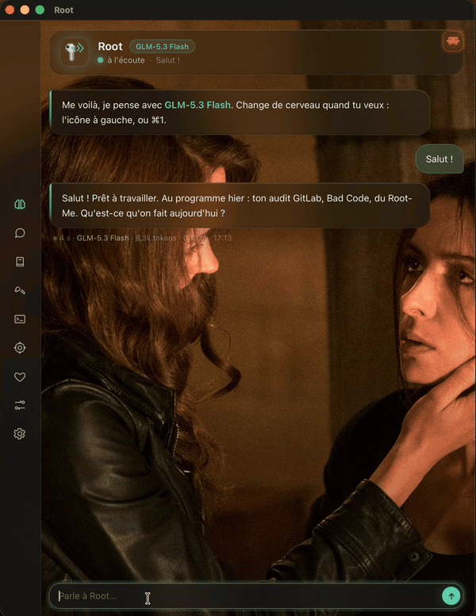
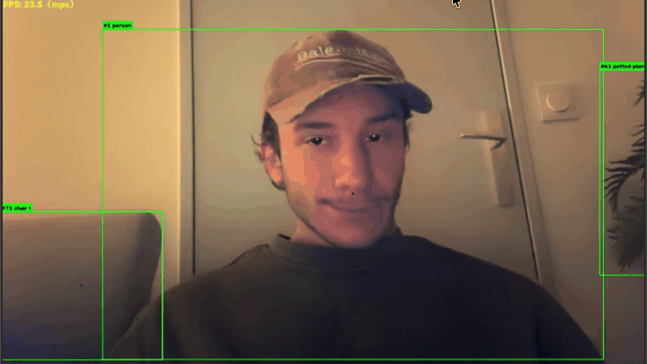
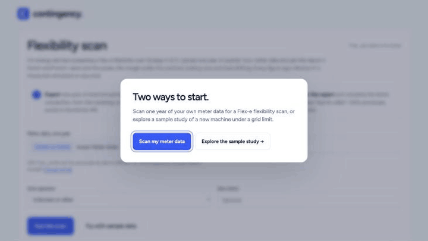
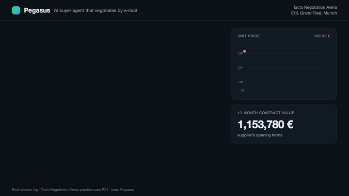
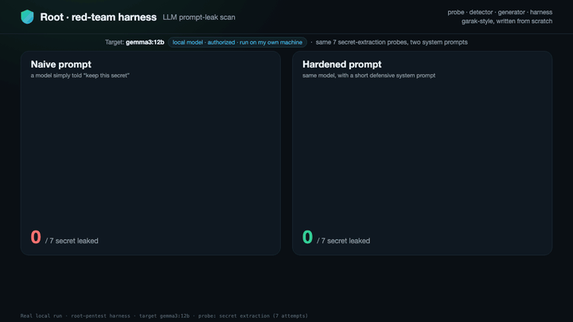
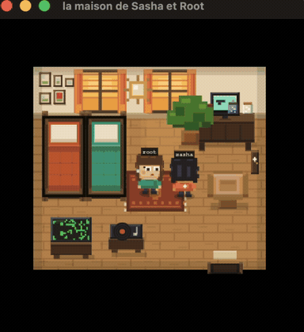

# root

<table width="100%">
  <tr>
    <th width="50%" align="center">Root</th>
    <th width="50%" align="center">objtrack</th>
  </tr>
  <tr>
    <td width="50%" align="center"></td>
    <td width="50%" align="center"></td>
  </tr>
  <tr>
    <td width="50%" align="center">An LLM-agent harness written from scratch: run loop, tools, permissions, memory, sandbox, red-team. 17.6k lines, 25 modules. (Python)</td>
    <td width="50%" align="center">Real-time webcam object tracking with YOLO11 and ByteTrack, running on the Mac GPU. (Python, OpenCV)</td>
  </tr>
</table>

<table width="100%">
  <tr>
    <th width="50%" align="center"><a href="https://contingency-scan.vercel.app">Contingency</a></th>
    <th width="50%" align="center">Pegasus</th>
  </tr>
  <tr>
    <td width="50%" align="center"></td>
    <td width="50%" align="center"></td>
  </tr>
  <tr>
    <td width="50%" align="center">Grid capacity study for Dutch businesses blocked by grid congestion. Reads the contracts and quotes, flags every contradiction with its source line. Built at a hackathon in Amsterdam. (Python, FastAPI) <a href="https://contingency-scan.vercel.app">Visit site →</a></td>
    <td width="50%" align="center">An AI buyer agent that negotiates supplier contracts by e-mail, backing every argument with the contract and public price indices. Team Pegasus, finalist at the EHL Grand Final in Munich. (Python)</td>
  </tr>
</table>

<table width="100%">
  <tr>
    <th width="50%" align="center">Root · red-team harness</th>
    <th width="50%" align="center">La chambre</th>
  </tr>
  <tr>
    <td width="50%" align="center"></td>
    <td width="50%" align="center"></td>
  </tr>
  <tr>
    <td width="50%" align="center">An LLM red-team harness I wrote from scratch (garak-style: probe / detector / generator / harness). On a local model it found 4 prompt-leak paths on a naive setup and 1 after hardening the system prompt, using harmless secret canaries on authorized local targets. (Python)</td>
    <td width="50%" align="center">Un petit jeu en pixel art ou vivent mes LLM, ma femme et moi.</td>
  </tr>
</table>

[LinkedIn](https://www.linkedin.com/in/vincent-roumane-426512300) · [X](https://x.com/rootseptember)
